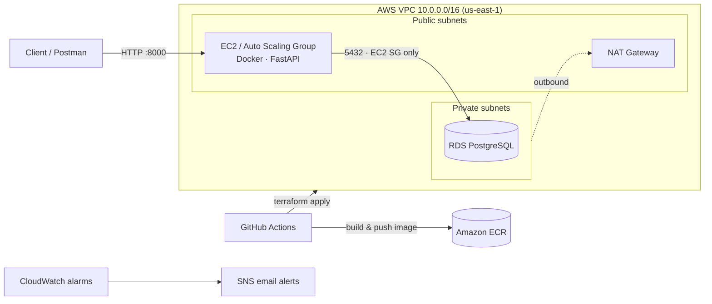

# ALLSTARS — Secure E-Commerce Backend on AWS

Capstone project (Sheridan College, Cloud Security program): a FastAPI + PostgreSQL e-commerce backend, containerized with Docker and deployed to AWS with modular Terraform and GitHub Actions — designed around least-privilege networking and security scanning.

**Team:** Sai Rohith Suri (Cloud Infrastructure & Terraform) · **Dinesh Chette (GitHub CI/CD)** · Tejaswini Venkataraju Madiraju (SAST scans)

---

## What it does

Two user roles:

- **Customer** — registers with a mobile number, browses categories → subcategories → products, manages a cart, places orders and views order history.
- **Admin** — full CRUD on categories, subcategories and products; views all orders and updates payment status.

## Architecture



## Tech stack

| Area | Tools |
|---|---|
| Backend | Python, FastAPI, SQLAlchemy, Pydantic, JWT auth (passlib/bcrypt) |
| Database | PostgreSQL (Docker locally, Amazon RDS in AWS) |
| Containers | Docker, docker-compose, Amazon ECR |
| Infrastructure as Code | Terraform (modules: `vpc`, `ec2`, `ec2_asg`, `rds`, `s3`) |
| AWS | VPC, subnets, IGW/NAT, EC2, Auto Scaling, RDS, S3, CloudWatch, SNS |
| CI/CD | GitHub Actions (`deploy.yml`, `codeql.yml`) |
| Security testing | GitHub CodeQL (SAST), Checkov (IaC scanning), Pytest |

## Security design

- **Network segmentation** — RDS sits in private subnets with no public access; private subnets reach the internet only through a NAT Gateway.
- **Least-privilege security groups** — PostgreSQL (5432) accepts traffic only from the EC2 security group; SSH is restricted to a single trusted IP.
- **Network ACLs** — separate public/private NACLs as a second layer of defence.
- **Encrypted, private S3** — server-side encryption enabled and all public access blocked.
- **Monitoring** — CloudWatch CPU alarms on EC2 and RDS publish to an SNS email topic.
- **SAST** — CodeQL runs on every push and pull request; findings were remediated (sanitized queries, removed unsafe defaults).
- **Secrets** — credentials are supplied through `.env`, `.env.db`, `terraform.tfvars` and GitHub Secrets, none of which are committed (see the `*.example` files).

## My role — CI/CD (Dinesh Chette)

- Built the GitHub Actions deployment pipeline: authenticate to AWS with repository secrets → build the Docker image → push to Amazon ECR → install Terraform → `terraform init` / `apply`.
- Integrated CodeQL static analysis into the workflow so every push and PR is scanned.
- Managed the repository workflow and branch practices for the team.

## Run locally

```bash
cp .env.example .env
cp .env.db.example .env.db      # set a real password in both files
docker-compose up --build
```

API docs: <http://localhost:8000/docs>

Tests:

```bash
pip install -r requirements.txt
pytest
```

## Deploy to AWS

```bash
cd iac
cp terraform.tfvars.example terraform.tfvars   # fill in your values
terraform init
terraform plan
terraform apply
```

In this portfolio copy the **Deploy to AWS** workflow is manual (`workflow_dispatch`) and needs `AWS_ACCESS_KEY_ID`, `AWS_SECRET_ACCESS_KEY` (and optionally `AWS_SESSION_TOKEN`) set as repository secrets.

## Project structure

```
app/            FastAPI app — auth, admin, products, cart, orders, users
tests/          Pytest suite
iac/            Terraform root module + modules/{vpc,ec2,ec2_asg,rds,s3}
.github/        GitHub Actions workflows (deploy, CodeQL)
Dockerfile, docker-compose.yml
```

## Note

This is a cleaned portfolio copy of the original team repository: credentials, key pairs and environment-specific values were removed from the full history. The AWS environment used during the course has been decommissioned.
